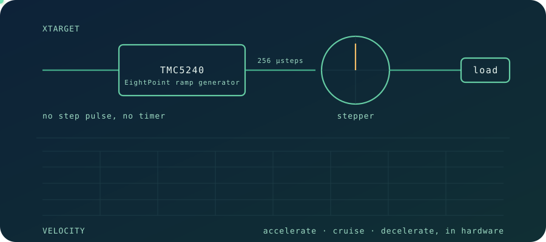

<p align="center">
  
</p>

# mcu-stepper

<p align="center">
  
  
  
</p>

A small C stepper driver library for **ESP-IDF 5.2+** and **STM32 HAL**. Two
Trinamic/ADI chips keep their own handle APIs, and share one `struct
stepper_dev` for what they do the same way: the enable pin, run and hold
current in **RMS amperes**, and a decoded status. Motion stays with each
chip. This library replaces `esp-tmc2209-stepper` and
`esp-tmc5240-stepper`; the STM32 port is new.

The repository is named `mcu-stepper`; the C API, `CONFIG_STEPPER_*`
options and forge package key are `stepper`. The clone command below names
the ESP-IDF component directory `stepper` as well.

> **Hardware unverified.** Host tests use simulated devices and platform stubs.
> Nothing here has run on a physical chip. The TMC5240's acceleration scale
> in particular follows its datasheet against the older parts' formula and
> waits for a bench run; see [the chip reference](docs/chips.md#acceleration-scale).

[Supported hardware](#supported-hardware) · [Install](#install) ·
[Quick start](#quick-start) · [Examples](#examples) ·
[Documentation](#documentation) · [Tests](#tests)

## Supported hardware

Both drivers support both platforms. Enable only the drivers you need.

| Chip | Interface | Moves by |
|---|---|---|
| **TMC2209** | single-wire UART, addresses 0–3 | STEP/DIR from the app, or a velocity to its own pulse generator (`tmc2209_move()`) |
| **TMC5240** | SPI, mode 3 | its ramp generator: a target position, hardware acceleration (`tmc5240_move_to()`) |

Wiring for both is in the [wiring guide](docs/hardware.md).

## Install

### ESP-IDF

Clone into your project's components directory:

```sh
git clone https://github.com/JonasAtelier/mcu-stepper components/stepper
```

Enable your chips in `idf.py menuconfig` → **Component config → Stepper
driver subsystem**, or add this to `sdkconfig.defaults` for the TMC2209:

```ini
CONFIG_STEPPER=y
CONFIG_STEPPER_TMC2209=y
```

The `main` component sees the library automatically. Other components declare
`REQUIRES stepper driver` in `idf_component_register()`.

### esp-forge / stm-forge

stm-forge must be at `ee921c3` or later, which builds the chip folders in
`src/`; older ones fail at link with undefined chip functions.

Add to `profiles/pkgversion`:

```make
stepper_GIT=https://github.com/JonasAtelier/mcu-stepper@stable
```

Enable the package and your chip in `configs/<target>_defconfig`:

```make
PKG_stepper         = y
STEPPER_TMC2209     = y
```

### STM32 HAL without forge

Compile every `.c` under `src/`, chip folders included, add `include/` and
`src/` to the include path, and define `CMSIS_device_header` as your family
header (`"stm32f4xx.h"` or `"stm32f7xx.h"`), `USE_HAL_DRIVER`, and
`CONFIG_STEPPER_<CHIP>=1` for each selected chip. Enable and compile the HAL
module each chip needs: UART for the TMC2209, SPI for the TMC5240.

**No chip driver is enabled by default.** See the
[installation guide](docs/installation.md) for all options.

## Quick start

The bus is the app's. On ESP-IDF install and configure the UART, then hand
the TMC2209 driver the port:

```c
#include "driver/uart.h"
#include "stepper.h"
#include "tmc2209.h"

esp_err_t spin(void)
{
    const uart_config_t uc = {
        .baud_rate = 115200, .data_bits = UART_DATA_8_BITS,
        .parity = UART_PARITY_DISABLE, .stop_bits = UART_STOP_BITS_1,
        .flow_ctrl = UART_HW_FLOWCTRL_DISABLE, .source_clk = UART_SCLK_DEFAULT,
    };
    tmc2209_config_t cfg = {
        .uart = UART_NUM_1, .en_gpio = GPIO_NUM_4,
        .rsense_mohm = 110.0f,          /* the sense resistors fitted */
        .run_current_ma = 600,          /* RMS */
        .microsteps = 16,
    };
    tmc2209_handle_t drv;

    ESP_ERROR_CHECK(uart_driver_install(UART_NUM_1, 256, 256, 0, NULL, 0));
    ESP_ERROR_CHECK(uart_param_config(UART_NUM_1, &uc));
    ESP_ERROR_CHECK(uart_set_pin(UART_NUM_1, 17, 16, UART_PIN_NO_CHANGE,
                                 UART_PIN_NO_CHANGE));

    ESP_ERROR_CHECK(tmc2209_init(&cfg, &drv));
    stepper_enable(tmc2209_stepper(drv), true);
    return tmc2209_move(drv, 3200.0f);  /* one turn a second, no STEP pin */
}
```

On STM32 the config takes a `UART_HandleTypeDef *` the app has
`HAL_UART_Init()`ed, and the enable pin as a port and pin; the
[snippets](examples/stm/) show both chips.

- `tmc2209_stepper()` and `tmc5240_stepper()` give the chip as a
  `struct stepper_dev *` for `stepper_enable()`, `stepper_set_current()`
  (amperes RMS) and `stepper_read_status()`.
- On ESP-IDF the chip calls return `esp_err_t`, as the original drivers did;
  on the HAL, **0 or a negative errno**. `stepper_*` is errno on both.
- The UART and SPI bus are the app's on both platforms; the enable pin is
  the driver's. See [API usage](docs/usage.md#buses-are-the-apps).

## Examples

| Chip | ESP-IDF | STM32 HAL |
|---|---|---|
| TMC2209 | [tmc2209](examples/esp/tmc2209/) | [tmc2209](examples/stm/tmc2209/main.c) |
| TMC5240 | [tmc5240](examples/esp/tmc5240/) | [tmc5240](examples/stm/tmc5240/main.c) |

ESP-IDF examples already locate this library through `EXTRA_COMPONENT_DIRS`,
which assumes the repository is checked out as `stepper`. With ESP-IDF
activated, build from an example directory:

```sh
cd examples/esp/tmc2209
idf.py set-target esp32 # Replace with your board's target.
idf.py build
```

STM32 examples are snippets to integrate into your application, with clock
setup, the bus as CubeMX generates it, and logging retargeting provided by
you.

## Scope and limitations

- **No step pulses, no host-side ramps.** The TMC2209 moves by STEP/DIR you
  generate, or by its own velocity generator; the TMC5240 by its ramp
  generator.
- **No shared motion API**, deliberately: one would be wrong for one chip.
- **No CoolStep tuning, no OTP, no TMC5240 encoder block or UART.** The
  registers are reachable through `tmc2209_read/write` and
  `tmc5240_read/write`.
- **Concurrency:** on ESP-IDF the TMC5240 holds a mutex across each datagram
  chain; on the HAL there is none, so call each chip from one context. The
  TMC2209 has no lock on either platform: one task per chip, or your own
  mutex.

## Documentation

| Guide | Contents |
|---|---|
| [Installation](docs/installation.md) | Forge, ESP-IDF, STM32 HAL, build options and logging setup |
| [Hardware](docs/hardware.md) | Wiring and pins for each chip, the single UART wire |
| [API usage](docs/usage.md) | Handles and the category view, buses, current, timing, errors, changes from the originals |
| [Chip reference](docs/chips.md) | Datagrams, current formulas, the ramp generator, the clock, provenance |
| [Development](docs/development.md) | Platform ports, bus abstraction, adding a driver and test coverage |

Public interfaces live in [include/](include/); chip drivers and platform ports
live in [src/](src/). The [repository layout](docs/development.md#repository-layout)
maps every directory.

## Tests

```sh
make -C test test
```

Host-only tests use stubbed HAL and ESP-IDF APIs; no embedded toolchain or
physical chip is needed. See the [test reference](docs/development.md#tests).
Error logs during the suite are expected: tests deliberately exercise
failure paths.

## License

[MIT](LICENSE)
