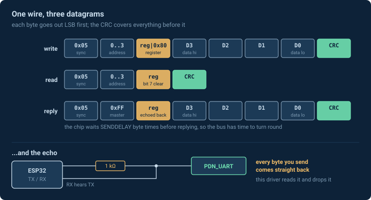

# Hardware wiring

[Back to README](../README.md)

Paths mentioned in this guide are relative to the repository root.

## Pins

On ESP-IDF any GPIO works; the GPIO numbers below are the ones the examples
in `examples/esp/` use, set at the top of each `main.c`. On STM32 the pins
are whatever the app's UART or SPI handle uses: the snippets in
`examples/stm/` take the handles as CubeMX generates them, and the chip
select and enable lines are outputs the app has set up. The bus init — pins,
clocks, baud rate, mode — is the app's on both platforms.

### TMC2209 — `examples/*/tmc2209`

The driver touches three pins: ENN, and the two ends of the one UART wire.
Everything else is yours to wire or to leave alone.

| pin | goes to | note |
|---|---|---|
| VS (`VM`) | the motor supply, 4.75 to 29 V | not the MCU's rail. Bulk capacitance close to the pin |
| VCC_IO (`VIO`) | 3.3 V | sets the logic level of every digital pin, so tie it to the MCU's 3.3 V |
| GND | MCU GND **and** the motor supply's | shared ground, always |
| ENN | GPIO 4 | active low, driven by `tmc2209_enable()` and `stepper_enable()`. Tied to GND: `GPIO_NUM_NC` on ESP-IDF, `en_port = NULL` on STM32 |
| STEP | your pulse source, or nothing | not driven here; `tmc2209_move()` needs no STEP pin at all |
| DIR | your direction line, or nothing | likewise untouched — `cfg.invert_direction` flips direction over UART instead |
| MS1_AD0, MS2_AD1 | GND or VCC_IO | over UART these stop being microstep pins and strap `cfg.address`, 0 to 3 |
| PDN_UART | TX through 1 kOhm, RX direct | the one data wire; ESP-IDF example: GPIO 17 and 16. See below |
| DIAG | any GPIO, or nothing | driven high by the chip on a stall armed with `tmc2209_set_stall()`, or on a driver fault. Read it yourself |
| INDEX | any GPIO, or nothing | one pulse per *electrical* rotation — four fullsteps, not one turn |
| VREF | the board's trimmer, or nothing | ignored: the driver clears `I_scale_analog`, so the pot position does nothing |
| OA1, OA2 | motor coil A | one phase |
| OB1, OB2 | motor coil B | the other |

Pin names are from `docs/tmc2209.pdf` section 2.2, "Signal Descriptions";
SilentStepStick-style breakouts silkscreen VS and VCC_IO as VM and VIO.

#### The single UART wire

<p align="center">
  
</p>

Almost every breakout brings the UART out as **one wire**: MCU TX through a
1 kOhm resistor into PDN_UART, MCU RX straight onto it.

```
  MCU TX ──[ 1k ]──┬── PDN_UART
  MCU RX ──────────┘
```

The MCU therefore hears everything it says, and the driver takes that echo
off the line before it reads the reply. If your board really does break TX
and RX out separately, set `cfg.two_wire = true`.

On STM32 that is an ordinary full-duplex USART: TX and RX on their usual
pins, joined through the resistor. Do not put the USART in half-duplex
(HDSEL, `HAL_HalfDuplex_Init()`): the driver expects to hear its echo, a byte
at a time. Why it is done this way is in
[development.md](development.md#the-tmc2209s-echo).

`cfg.address` is 0 to 3, strapped on MS1 and MS2. Several chips can share
one wire as long as each has a different address — the driver sets
SENDDELAY so that works.

### TMC5240 — `examples/*/tmc5240`

**VS** is the motor rail and **VCC_IO** is the logic rail. They are separate
supplies and the chip needs both.

| pin | goes to | note |
|---|---|---|
| VS | the motor supply, up to 36 V | the power stage runs from this |
| VCC_IO | 3.3 V | logic supply, and it sets the level of every digital pin. Match the MCU |
| VDD1V8 | 2.2 µF to AGND | internal regulator **output**, not an input |
| VCP, CPO, CPI | their capacitors | charge pump: 1 µF from VCP to VS, 22 nF from CPI to CPO |
| AGND, PGND | GND | shared ground, always. The exposed pad too |
| SCK/AD1 | GPIO 12 | SPI clock |
| SDI/AD0 | GPIO 11 | MOSI |
| SDO/NAO | GPIO 13 | MISO, three-state |
| CSN/AD2 | GPIO 10 | one per chip on the bus; on STM32 a software chip select the driver toggles |
| UART_EN | GND | low selects SPI. This driver is SPI only |
| DRV_ENN | GPIO 9 | the driver **drives** it; high floats the motor outputs. Tied to GND: `-1` on ESP-IDF, `en_port = NULL` on STM32 |
| IREF | a resistor to GND, 12 to 60 kΩ | `rref_kohm` must be that resistor — see [the chip reference](chips.md#motor-current) |
| CLK | GND, or a clock from the MCU | GND picks the internal oscillator — see [the clock](chips.md#the-clock-is-the-calibration-knob) |
| DIAG0, DIAG1/SW | nothing | not used by this driver; leave open. Open drain, so they want a pull-up if you do use them |
| REFL, REFR | nothing | reference switches, and `SW_MODE` is cleared at init; leave open |
| ENCA, ENCB, ENCN | nothing | the encoder block is not implemented; leave open |
| SLEEPN | VCC_IO | a continuous low sleeps the chip and loses every register. The driver never does this |
| OUT1A/OUT2A, OUT1B/OUT2B | the motor's two coils | one pair per coil |

Names are the datasheet's, from `docs/tmc5240.pdf` section 7.

SPI mode 3 ("The SPI interface uses SPI MODE 3", p.25), at most 10 MHz,
40 clocks per datagram (p.24-25). On ESP-IDF the driver adds the device at
4 MHz unless `cfg.spi_hz` says otherwise; on STM32 the clock and mode are
the handle's, and init refuses a handle not in mode 3 with 8-bit frames.
Each 40-bit datagram is its own chip select: a hardware NSS that stays low
across transfers will not do.
